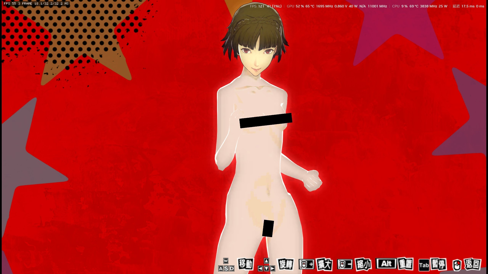

# PSV P5D 女角色裸体模组

**Persona 5 Dancing in Starlight (PCSH10109) 女角色裸体模组**：把游戏里四位女性角色的**泳装模型**替换为**裸体模型**，
进入游戏后选择对应角色的**泳装**即可看到效果。

> 作者：**凯梦** ｜ 版本：**v30.0** ｜ 适用版本：P5D 亚洲版（PCSH10109）

---

## 替换角色

| 角色 | 实机效果 | 替换文件 |
|---|---|---|
| 高卷杏（Ann） |  | `pc204_07.GMD` |
| 新岛真（Makoto） |  | `pc206_07.GMD` |
| 奥村春（Haru） |  | `pc207_07.GMD` |
| 佐仓双叶（Futaba） |  | `pc208_07.GMD` |

> 以上截图为 **P5D PC 移植版**实机效果；替换的均为各角色**泳装**服装槽位。

---

## 下载

到本仓库的 **[Releases](https://github.com/kaimeng114514/psv-p5d-female-nude-mod/releases)** 页面下载最新版本：
`psv.p5d.female.nude.mod.rar`

解压后得到：

```
P5D女角色裸体模组/
├── Mod.xml
└── Data/
    └── dance/player/p5/
        ├── pc204_07.GMD
        ├── pc206_07.GMD
        ├── pc207_07.GMD
        └── pc208_07.GMD
```

---

## 安装与使用

### P5D PC 移植版（已验证）

1. 下载并解压本模组（保留 `Mod.xml` 和 `Data` 文件夹结构）；
2. 打开 **P5D Windows 移植版启动器** → 「MOD」页 → 导入模组文件夹（Reloaded-II 格式：`Mod.xml` + `Data/`）；
3. 在 MOD 列表中**启用**本模组；
4. 启动游戏，进入对应角色的**泳装**服装即可。

> 移植版地址：<https://github.com/kaimeng114514/PSV-P5D-Asia-Recomp-port-PC>

### PSV 实机（已验证，2026-11-25）

需要：已破解的 PSV（3.60–3.68）+ **rePatch** 插件 + 你合法持有的 P5D 亚洲版（PCSH10109）。

**原理**：游戏从 `app0:/data/data.cpk` 加载全部模型；rePatch 可以把该文件整个替换成
"原内容 + 追加本模组 4 个 GMD" 的 CPK，游戏代码不用改，**不需要 patched eboot / mod.cpk**。

步骤：

1. 准备一个**含本模组**的 `data.cpk`（在 PC 上用 CPK 工具把 `data/dance/player/p5/pc20*_07.GMD`
   追加进原版 `data.cpk` 并改写目录表；PC 移植版启动器应用模组后的
   `<游戏库>/decrypted/PCSH10109/app0/data/data.cpk` 就是这种文件，约 1.92 GB）；
2. 用读卡器复制到：
   ```
   ux0:rePatch/PCSH10109/data/data.cpk
   ```
   （卡上留 ≥ 2 GB 空间；不需要 eboot.bin 或 mod.cpk）
3. 启动游戏 → 换装界面选对应角色的**泳装** → 模型替换成功；
4. 回滚：删除 `ux0:rePatch/PCSH10109` 整个目录即可（原版 data.cpk 未被修改）。

> 注意：修改后的 `data.cpk` 含游戏数据，**只能个人使用，禁止上传分享**。
>
> 小 `mod.cpk` 方案（2.2 MB）在实机未走通：需要 FAGDec 格式的 patched eboot，
> 而普通 dump（MaiDump 风格解密 eboot）在 3.65 上会 `C2-12828-1` 崩溃。
> PSV 模拟器（Vita3K）未测试。

---

## 兼容性说明

- ✅ **P5D PC 移植版**已验证可用（截图为该平台实机效果）；
- ✅ **PSV 实机（3.60–3.68 + rePatch）**已验证可用（2026-11-25，data.cpk 替换法，见上）；
- 模组只替换模型文件，不含游戏本体；请自备游戏本体。

---

## 作者与致谢

- **模组作者（模型制作/移植/绑定）**：凯梦
  - 裸体模型由作者本人在游戏原版模型基础上制作并绑定；
- **纹理贴图来源**：借用自 **P5R 裸体模组**，作者 **jmedia7**
  - 原帖：<https://www.loverslab.com/topic/199294-persona-5-royal-modding/#findComment-3899717>
  - **特别感谢 jmedia7 提供的裸体纹理贴图**——本模组仅**贴图**借用自该 P5R 裸体模组，模型为作者本人制作。

---

## 作者与授权

- **作者**：本模组作者（以本仓库的提交记录与发布记录为准） · 首次发布：**v30.0（2026-11-21）**
- **授权方式**：作者**不主张本模组原创部分的经济权利，不收取任何费用**；依著作权法**保留署名权**（表明作者身份的权利），**希望在转载、修改、再分发时保留原作者署名及本仓库原始链接**：
  <https://github.com/kaimeng114514/psv-p5d-female-nude-mod>
- **权利归属**：
  - 模型/绑定中**衍生自游戏原作**的部分，权利归原权利人（ATLUS / SEGA）；
  - **贴图**来源于 jmedia7 的 P5R 裸体模组，其权利归原作者 **jmedia7**；
  - 作者仅对"本模组由原作者制作"这一**作者身份**主张署名，不主张任何经济收益。

---

## 免责声明

- 本模组是**非商业的同人作品**，仅供个人学习与游戏使用，请勿用于商业用途；
- 模组中的模型衍生自《Persona 5 Dancing in Starlight》游戏模型，贴图借用自上述 P5R 裸体模组，
  相关版权归原权利方（ATLUS / SEGA）及原作者所有；
- 请在下载后 24 小时内删除（如所在地法律有相关规定），并支持正版游戏；
- 使用本模组造成的任何问题由使用者自行承担。

---

## 更新日志

### v30.0

- 首个发布版本：杏、真、春、双叶四位角色的泳装模型替换为裸体模型；
- 已在 P5D PC 移植版验证可用。
