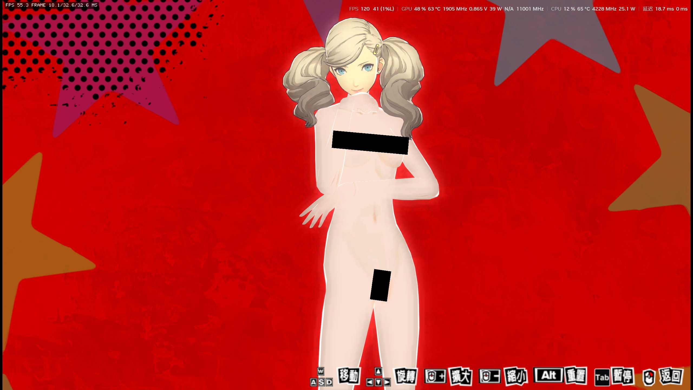
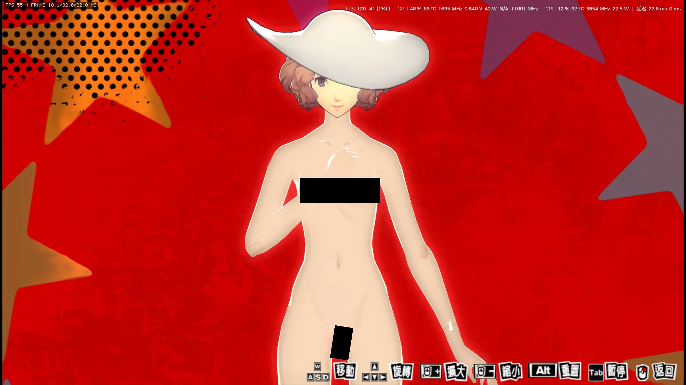
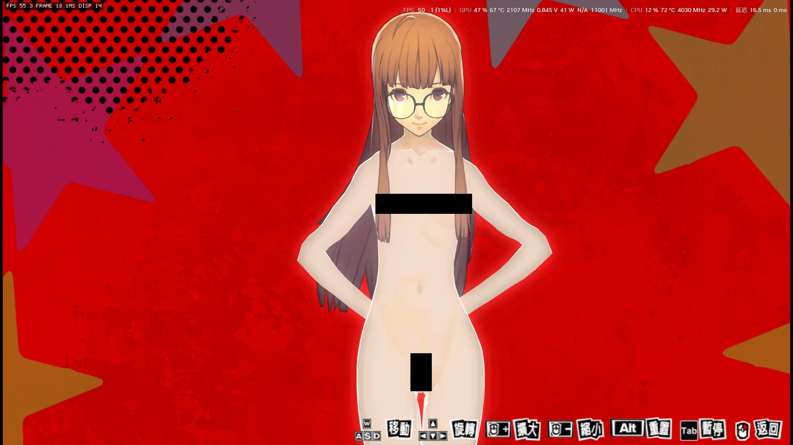

# PSV P5D 女角色裸体模组

**Persona 5 Dancing in Starlight (PCSH10109) 女角色裸体模组**：把游戏里四位女性角色的**泳装模型**替换为**裸体模型**，
进入游戏后选择对应角色的**泳装**即可看到效果。

> 作者：**凯梦** ｜ 版本：**v30.0-1**（模组本体 v30.0 + 新增 PSV 单 VPK 支持） ｜ 适用版本：P5D 亚洲版（PCSH10109）

---

## 免责声明

- 本模组是**非商业的同人作品**，仅供个人学习与游戏使用，请勿用于商业用途；
- 模组中的模型衍生自《Persona 5 Dancing in Starlight》游戏模型，贴图借用自上述 P5R 裸体模组，
  相关版权归原权利方（ATLUS / SEGA）及原作者所有；
- 请在下载后 24 小时内删除（如所在地法律有相关规定），并支持正版游戏；
- 使用本模组造成的任何问题由使用者自行承担。

---

## 替换角色

| 角色 | 实机效果 | 替换文件 |
|---|---|---|
| 高卷杏（Ann） |  | `pc204_07.GMD` |
| 新岛真（Makoto） |  | `pc206_07.GMD` |
| 奥村春（Haru） |  | `pc207_07.GMD` |
| 佐仓双叶（Futaba） |  | `pc208_07.GMD` |

> 以上截图为 **P5D PC 移植版**实机效果；替换的均为各角色**泳装**服装槽位。

---

## 下载

到本仓库的 **[Releases](https://github.com/kaimeng114514/psv-p5d-female-nude-mod/releases)** 页面下载：

- **v30.0-1（最新）**：新增 **PSV 实机单 VPK 支持**；模组本体（模型/贴图/`Data/` 文件）与 v30.0 **完全相同，未做任何修改**；
  - PC 移植版玩家：模组内容与 v30.0 相同，继续使用原有 `psv.p5d.female.nude.mod.rar` 即可；
  - PSV 实机玩家：使用 `P5DModInstaller.vpk`（见下文"PSV 实机（推荐）"）。
- **v30.0**：首个发布版本（模组本体）。

解压后得到：

```
P5D女角色裸体模组/
├── Mod.xml
└── Data/
    └── dance/player/p5/
        ├── pc204_07.GMD
        ├── pc206_07.GMD
        ├── pc207_07.GMD
        └── pc208_07.GMD
```

---

## 安装与使用

### P5D PC 移植版（已验证）

1. 下载并解压本模组（保留 `Mod.xml` 和 `Data` 文件夹结构）；
2. 打开 **P5D Windows 移植版启动器** → 「MOD」页 → 导入模组文件夹（Reloaded-II 格式：`Mod.xml` + `Data/`）；
3. 在 MOD 列表中**启用**本模组；
4. 启动游戏，进入对应角色的**泳装**服装即可。

> 移植版地址：<https://github.com/kaimeng114514/PSV-P5D-Asia-Recomp-port-PC>

### PSV 实机（推荐：单 VPK 全自动方案，2026-11-27 实机验证）

**玩家只需要安装一个 VPK、运行一次，即可完成全部安装**——不需要电脑、不需要 FAGDec、不需要手动复制文件。

下载：本仓库 `release/P5DModInstaller.vpk`（1,085,310 字节）

| 文件 | SHA256 |
|---|---|
| `P5DModInstaller.vpk` | `86FCC0F2F0144AA61F344E596E901AB2DA39C77DCA13BAEB444F293DC247413F` |

前置条件（缺一不可）：

1. PSV 已破解（HENkaku/taiHEN）；
2. **rePatch 插件已启用**（`ur0:tai/config.txt` 的 `*KERNEL` 段含 `ur0:tai/repatch.skprx`）；
3. 游戏 PCSH10109（P5D 亚洲版 1.00）已安装。

安装步骤：

1. 用 VitaShell 安装 `P5DModInstaller.vpk`（桌面显示中文名「P5D 模组安装器」）；
2. 运行「P5D 模组安装器」，等待中文界面提示「安装完成！请启动游戏。」（首次会自动解密，约几十秒）；
3. 启动游戏 → 换装选择泳装 → 模型已替换。

之后：

- **更换 MOD**：替换 `ux0:rePatch/PCSH10109/data/mod.cpk` 即可（无需再运行安装器）；
- **还原原版**：删除 `ux0:rePatch/PCSH10109/eboot.bin` 与 `data/mod.cpk`；
- **重装/更新游戏后**：再运行一次安装器。

安装器内部流程（详见 `docs/`）：挂载游戏 → 找许可证 rif → 加载解密内核模块（FAGDec 的
kentente/userAllied，GPLv3）解密游戏 eboot → 解压各段重建 ELF → 打 3-CPK 挂载补丁 →
用 zlib 重压缩与 SHA256 摘要重建 decrypted SELF → 写入 rePatch → 复制内置 mod.cpk。

技术要点（已写入 `docs/技术设计_单VPK方案.md`）：

- 原版 eboot 的代码页在运行时**不能被写入**（写回原值也会崩），所以放弃"插件运行时拦截"，改为**在主机上现场生成 patched eboot**；
- 解密内核模块需要 **UNSAFE SELF + authid 0x2808000000000000** 才能被 taiHEN 加载；
- 解密缓冲不能放到 CDRAM/内核根分区（3.1MB 段会 `NO_FREE_PHYSICAL_PAGE`），需依次尝试多个内核内存分区；
- SFO 标题必须是 UTF-8（`vita-mksfoex` 在中文 Windows 会写 GBK），整体重建 SFO 会安装报 `0x80105A03`，需**原结构内原地替换**；
- 界面中文用**1bpp 点阵位图**嵌入（不依赖系统字体）。

## 源码与工具（代码/技术资料）

本仓库公开模组相关的全部代码与技术资料（不含游戏数据）：

```
code/
├── installer/               # PSV 端单 VPK 安装器源码（MIT）
│   ├── src/                 # main.c / p5d_patch.c / p5d_inject.c / 中文字库 / debugScreen
│   ├── zlib/                # zlib 压缩/解压源码
│   ├── tools/gen_zh_font.ps1# 中文点阵生成脚本
│   └── build_vita.bat       # VitaSDK 构建脚本
└── fagdec/                  # 解密模块源码（PSVita-RE-Tools / FAGDec，GPLv3）
    ├── src/kplugin/         # kentente（SceSblAuthMgr 解密，含多分区内存分配修复）
    ├── src/uplugin/         # userAllied（用户层调用存根）
    └── include/             # 接口头文件

docs/
├── 技术设计_单VPK方案.md     # 完整技术设计与踩坑记录
├── 使用说明_单VPK版.md       # 玩家安装说明
└── 来源与许可.txt            # 第三方组件来源与许可

release/
└── P5DModInstaller.vpk      # 构建产物（单 VPK 安装器）
```

> 解密模块 `kentente` / `userAllied` 来自开源项目
> [PSVita-RE-Tools](https://github.com/TeamFAPS/PSVita-RE-Tools)（GPLv3）；
> 本仓库保存的是为当前方案适配/修复后的版本。安装器本体为自制 MIT 代码。

## 兼容性说明

- ✅ **P5D PC 移植版**已验证可用（截图为该平台实机效果）；
- ✅ **PSV 实机（3.60–3.68 + rePatch）**已验证可用（2026-11-26，小 mod.cpk 方案，见上）；
- 模组只替换模型文件，不含游戏本体；请自备游戏本体。

---

## 作者与致谢

- **模组作者（模型制作/移植/绑定）**：凯梦
  - 裸体模型由作者本人在游戏原版模型基础上制作并绑定；
- **纹理贴图来源**：借用自 **P5R 裸体模组**，作者 **jmedia7**
  - 原帖：<https://www.loverslab.com/topic/199294-persona-5-royal-modding/#findComment-3899717>
  - **特别感谢 jmedia7 提供的裸体纹理贴图**——本模组仅**贴图**借用自该 P5R 裸体模组，模型为作者本人制作。

---
